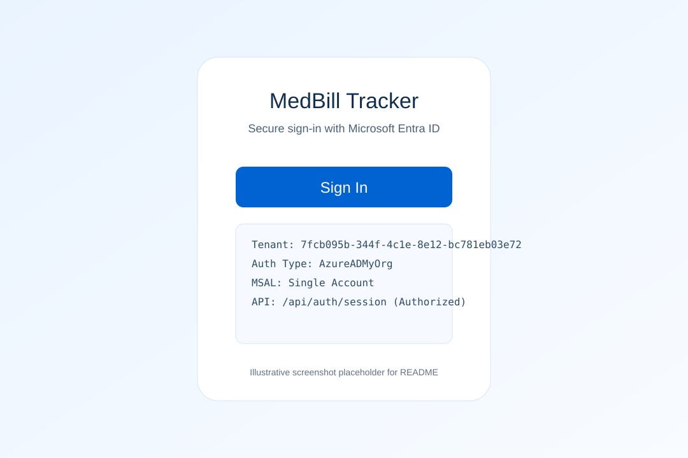
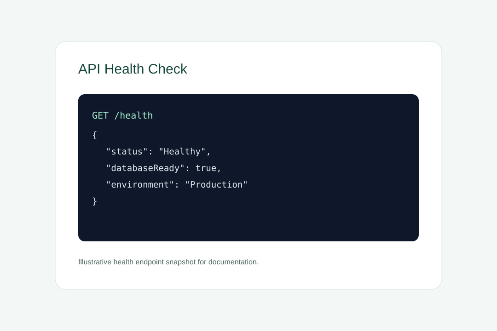
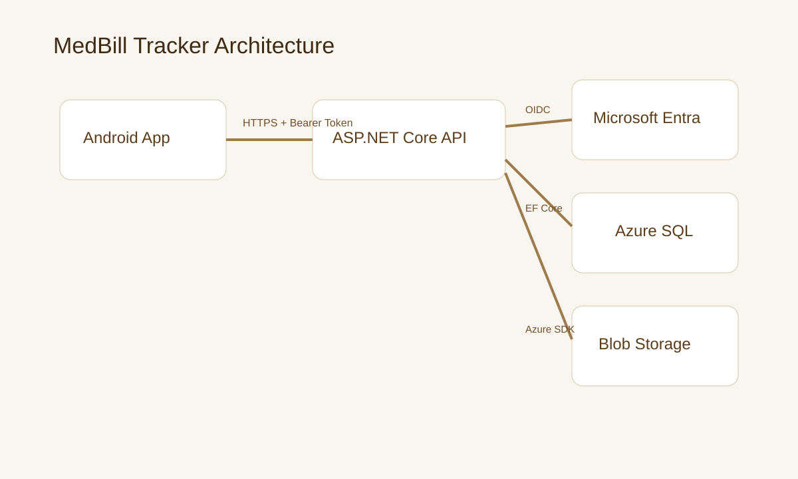

# MedBill Tracker

MedBill Tracker is a secure starter for Android medical bill tracking with an Azure-hosted ASP.NET Core backend and Bicep-based infrastructure.

<!-- project-downloads:start -->
## APK and installer downloads

Every available project package is indexed below, including older versions. Prefer the newest stable version for your platform and architecture. Debug APKs and prereleases are labeled; archives are not necessarily standalone installers.

No packaged APK or desktop installer is currently published in this repository. Source downloads and setup scripts are listed separately below; they are not prebuilt application installers.

### Setup scripts and source

- [Setup script: deploy-local.ps1](./deploy-local.ps1)

- [Download the complete source ZIP](https://github.com/jwgmpi-wolff/bill_tracking_public/archive/refs/heads/main.zip). Extract the complete checkout before running setup scripts unless the project instructions explicitly support standalone installation.
- [Browse all releases and their assets](https://github.com/jwgmpi-wolff/bill_tracking_public/releases).

Android may require approval to install apps from the download source. Follow the project-specific installation, signing, checksum, and prerequisite instructions elsewhere in this README.
<!-- project-downloads:end -->

## Feature summary

- Android app (`android/`) with Kotlin + Jetpack Compose + MSAL single-account auth
- .NET 8 API (`backend/MedBill.Api/`) with JWT bearer auth and health endpoints
- Azure IaC (`infra/`) for App Service, SQL, Storage, Key Vault, and App Insights
- Deployment scripts for local and Azure workflows
- Download page (`web/download/index.html`) for release APK metadata

## Screenshots





## Deploy To Azure

[](https://portal.azure.com/#create/Microsoft.Template/uri/https://raw.githubusercontent.com/OWNER/REPO/main/infra/main.azuredeploy.json)

Update `OWNER/REPO` after you push this repository.

## Local deployment

Run backend locally and keep logs attached:

```powershell
./deploy-local.ps1
```

Custom port:

```powershell
./deploy-local.ps1 -BackendPort 5180
```

Android emulator should target:

```text
http://10.0.2.2:<backend-port>/
```

## Azure deployment

### Fast path (your own tenant + subscription)

Authenticate first (required when your tenant enforces MFA/Conditional Access):

```powershell
az login --tenant <your-tenant-guid>
az account set --subscription <your-subscription-guid>
```

```powershell
./deploy-azure.ps1 \
  -TenantId <your-tenant-guid> \
  -SubscriptionId <your-subscription-guid> \
  -ResourceGroup rg-medbill-tracker \
  -Location eastus \
  -ApiAudience api://<your-api-app-id>
```

Before building Android, set your app-specific values:

```powershell
$env:MEDBILL_API_BASE_URL = "https://<your-app-service>.azurewebsites.net/"
$env:MEDBILL_ENTRA_CLIENT_ID = "<your-android-app-client-id>"
$env:MEDBILL_ENTRA_TENANT_ID = "<your-tenant-guid>"
$env:MEDBILL_ENTRA_API_SCOPE = "api://<your-api-app-id>/user_impersonation"
```

What this script does:

1. Sets Azure subscription context.
2. Deploys `infra/main.bicep` with SQL public network enabled and `AllowAzureServices` firewall rule.
3. Publishes API, zips output, deploys to App Service.
4. Applies app settings (`Jwt__Authority`, `Jwt__Audience`, SQL connection string, startup safety flags).

### Infrastructure-only options

```powershell
./scripts/deploy-infra.ps1 -ResourceGroup rg-medbill-tracker -Location eastus -DeployAppService:$true -DeploySql:$false
```

```powershell
./scripts/deploy-infra-auto-region.ps1 -DeployAppService:$true -DeploySql:$true
```

## Authentication model

- Android MSAL is single-tenant (`AzureADMyOrg`).
- API session endpoint requires auth: `GET /api/auth/session`.
- Unauthenticated calls return `401` as expected.

## Android build outputs

- APK: `android/app/build/outputs/apk/release/app-release.apk`
- AAB: `android/app/build/outputs/bundle/release/app-release.aab`
- Downloadable release APK: `releases/MedBillTracker-v1.0.1.apk`
- Release notes: `releases/README.md`
- Download metadata page: `web/download/index.html`

## Regenerate Prompt (GitHub Copilot)

Use this prompt to regenerate this repository from scratch with the same architecture and deployment behavior:

```text
Create a production-ready starter app called MedBill Tracker with these requirements:

1) Solution layout
- android/: Kotlin Android app using Jetpack Compose and MSAL single-account auth.
- backend/MedBill.Api/: ASP.NET Core .NET 8 Web API.
- infra/: Bicep IaC for App Service, SQL, Storage, Key Vault, and App Insights.
- scripts/: PowerShell deployment/validation helpers.
- web/download/: static release landing page that reads release.json.

2) Security/auth
- Android auth must be single-tenant (AzureADMyOrg), not common.
- Expose authorized API endpoint /api/auth/session that returns user/session claims.
- JWT validation settings via Jwt__Authority and Jwt__Audience app settings.
- Keep SQL public network configurable, with AllowAzureServices option for App Service connectivity.

3) Reliability
- API startup should run migrations with safe degraded mode option.
- Add public status endpoints:
  - GET / returns service + databaseReady state
  - GET /health returns healthy or degraded details

4) Deployment scripts
- Root deploy-local.ps1 to run API locally and print emulator URL.
- Root deploy-azure.ps1 to:
  - set tenant/subscription context
  - deploy Bicep template
  - publish + zip + deploy backend to App Service
  - set app settings for JWT and SQL connection
- scripts/deploy-infra.ps1 and scripts/deploy-infra-auto-region.ps1 for flexible infra rollout.

5) CI/CD
- GitHub Actions workflow with backend build, Android release build, Azure deploy, and artifact upload.

6) Documentation
- README with local deployment, Azure deployment commands, Deploy to Azure button, screenshot references, and APK/AAB paths.
- Include docs/screenshots assets and reference them from README.

7) Constraints
- Use ASCII for generated source by default.
- Avoid storing payment card data.
- Keep code comments concise and only where needed.
```

## CI/CD secret requirements

- `AZURE_CLIENT_ID`
- `AZURE_TENANT_ID`
- `AZURE_SUBSCRIPTION_ID`
- `SQL_ADMIN_PASSWORD`
- `STORAGE_ACCOUNT_NAME`
- `ANDROID_KEYSTORE_BASE64`
- `ANDROID_KEYSTORE_PASSWORD`
- `ANDROID_KEY_ALIAS`
- `ANDROID_KEY_PASSWORD`

## Compliance note

This starter requires legal, privacy, and security review before any HIPAA/HITECH or PCI-regulated production usage.

## Copyright

Copyright (c) 2026 Jerry Wolff. See [COPYRIGHT](COPYRIGHT) for the scope of this
notice. Existing licenses and third-party attribution remain unchanged; this
notice does not grant additional permissions.
